  

 

# Hey, I'm Naynesh Zade 👋

### Software Developer | Full-Stack Development | AWS Cloud | DevOps

Building web applications · System Design · Exploring Generative AI

---

## 💫 About Me

Software Developer and AWS Cloud Engineer with a B.Tech in Computer Science and Engineering (2026), specializing in building and deploying full-stack applications. I combine MERN stack skills (React.js, Node.js, Express.js, MongoDB) with hands-on AWS experience to build solutions from interface to infrastructure.

Through my AWS Cloud internship, I gained practical experience deploying applications, managing EC2 and S3 resources, and working with secure access controls using IAM. I approach development with performance, security, and maintainability in mind.

I’m passionate about connecting modern web development with cloud infrastructure and continuously expanding my skills in DevOps. As a recent graduate, I bring strong fundamentals, a fast-learning mindset, and a drive to contribute to engineering teams.

**Core Skills:** React.js · JavaScript (ES6+) · Node.js · Express.js · MongoDB · REST APIs · AWS (EC2, S3, IAM) · Tailwind CSS · Git & GitHub

**Open to:** Software Developer, Full-Stack Developer, and Cloud Engineer opportunities.

**Email:** [nayneshzade@gmail.com](mailto:nayneshzade@gmail.com)

## 🌐 Socials

## 💻 Tech Stack

**Languages**

**Frontend & Frameworks**

**Backend, APIs & Database**

**Cloud, Tools & Other Technologies**

## 🚀 Featured Projects

| Project | Description | Technologies |
| --- | --- | --- |
| **BUYNEST** | Full-stack marketplace project | MERN Stack |
| **SkyMart** | E-commerce web application | React, Tailwind CSS |
| **Ease UI** | Reusable UI component library | React, TypeScript |
| **Frontend Projects** | Collection of frontend practice projects | HTML, CSS, JavaScript |
| **AWS Cloud Project** | Cloud deployment project using EC2 and S3 | AWS |

Explore my [GitHub repositories](https://github.com/Naynesh-coder?tab=repositories) for project code and updates.

## 📊 GitHub Stats

  
   
  
   
  

## 🎯 Currently Learning & Improving

- Building full-stack applications and backend APIs
- Practicing Data Structures & Algorithms
- Learning AWS cloud services and DevOps workflows
- Exploring system design and Generative AI

---

### `Code. Learn. Build. Repeat.`

